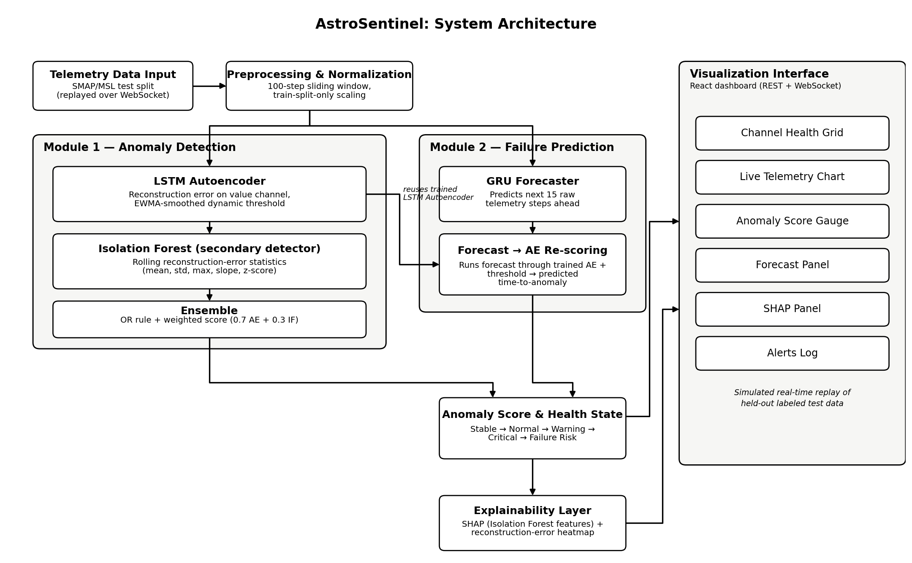

# AstroSentinel

Spacecraft telemetry anomaly detection & failure prediction, built on NASA's
SMAP/MSL benchmark dataset. See [plan.md](plan.md) for the full design,
scope, and rationale.

## Architecture



Telemetry is windowed and normalized, then run through two parallel modules:
**detection** (an LSTM Autoencoder's reconstruction error, cross-checked by an
Isolation Forest on rolling error statistics, combined into one ensemble score
and health state) and **prediction** (a GRU forecaster projects the next 15
steps, which are re-scored through the same trained autoencoder to estimate a
predicted time-to-anomaly). An explainability layer attaches SHAP feature
attribution plus a reconstruction-error heatmap to any detected anomaly.
Everything is served over REST + WebSocket to a live React dashboard.

- **`ml/`** — data pipeline, LSTM Autoencoder + Isolation Forest (detection),
  GRU forecaster (failure prediction), SHAP explainability, training/eval.
- **`backend/`** — FastAPI REST + WebSocket API serving live inference over a
  simulated real-time replay of the held-out test data.
- **`frontend/`** — React (Vite + TS) dashboard: channel health grid, live
  telemetry chart with anomaly overlays, forecast panel, SHAP panel, alerts log.
- **`docker/`** + **`docker-compose.yml`** — containerized trainer + backend
  + frontend.

## Quickstart (Docker)

1. **Stage the dataset** (downloads via kagglehub if not already cached, then
   copies the 10 curated channels into the gitignored `data/raw/`):

   ```bash
   python scripts/download_dataset.py
   python scripts/stage_data.py
   # or: make data
   ```

2. **Train all 10 channels** (one-shot container, writes `ml/artifacts/`):

   ```bash
   docker compose --profile train run --rm trainer
   # or: make train
   ```

   Takes a few minutes on a laptop CPU. Re-run any time to retrain.

3. **Start the app**:

   ```bash
   docker compose up --build
   # or: make up
   ```

   Frontend: http://localhost:5173 — Backend API: http://localhost:8000

The backend fails fast at startup if `ml/artifacts/manifest.json` is
missing — step 2 is required before step 3.

## Local development (without Docker)

Requires Python 3.11+ and Node 20+.

```bash
# ML / training
pip install -r ml/requirements.txt
cd ml && PYTHONPATH=. python -m pytest tests/ -q      # unit tests
PYTHONPATH=. python -m ml.training.train_all           # from ml/, trains all 10 channels

# Backend
pip install -r backend/requirements.txt
cd backend && PYTHONPATH=../ml python -m uvicorn app.main:app --reload

# Frontend
cd frontend && npm install && npm run dev
```

## Repo layout

```
AstroSentinel/
├── plan.md                 Full design doc: scope, architecture, open questions
├── docs/                     architecture.svg
├── scripts/                 download_dataset.py, stage_data.py
├── data/                     [gitignored] staged dataset
├── ml/                        data pipeline, models, training, evaluation
│   └── artifacts/            [gitignored] trained model artifacts + manifest.json
├── backend/                 FastAPI app
├── frontend/                 React app
├── docker/                   trainer.Dockerfile
└── docker-compose.yml
```

## Testing

```bash
make test          # ML unit tests (windowing, thresholding, ensemble logic)
```
